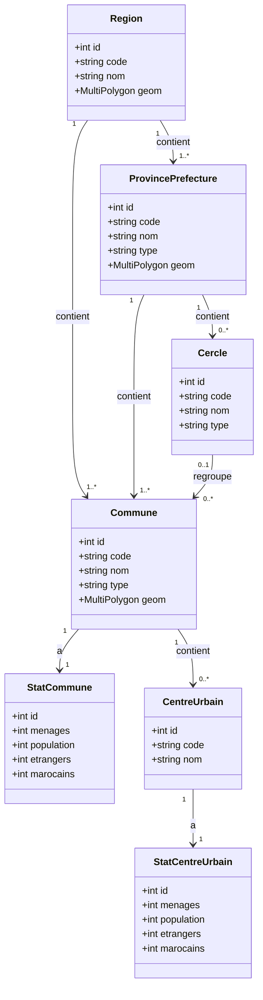

# TP1 Geo BI : découpage administratif du Maroc (RGPH 2004) dans PostgreSQL/PostGIS

## Sources
| Fichier | Contenu |
|---|---|
| `population.xlsx` | RGPH 2004 : feuilles Regions, Provinces, Communes (ménages, population, étrangers, marocains) |
| `shp_sources/region.shp` | 16 régions (`code_regio`), WGS84 |
| `shp_sources/province.shp` | 75 provinces/préfectures (`code_provi`) |
| `shp_sources/commune.shp` | 1 538 communes (`code_commu`) : shp de l'**Option 2** (jointure sur le code) |

## I. Modélisation

### Diagramme de classes



### Choix de modélisation
- Les **codes** reprennent le *Code Géographique* du RGPH sans le point final : région `01`, province `066` (code national, comme dans `province.shp`), cercle `01.066.03`, commune `01.066.03.05` (comme dans `commune.shp`), centre `03.261.03.11.3`.
- `province_prefecture.type` : `Province` / `Préfecture`.
- `cercle.type` : `Cercle`, ou `Préfecture d'arrondissements` pour les 8 subdivisions de Casablanca (`09.141.01.0` à `.7`).
- `commune.type` : `Commune rurale`, `Municipalité` `(Mun.)` ou `Arrondissement` `(Arrond.)`.
- `commune.cercle_id` est **NULL** pour les municipalités, les arrondissements hors Casablanca et le Méchouar de Casablanca.
- Ajout de `geom geometry(MultiPolygon, 4326)` dans `region`, `province_prefecture` et `commune`, avec un index GiST.
- Schéma `staging` : tables de transit, réutilisées par SSIS.

## Arborescence
```
sql/01_create_database.sql        I.   création de la base geobi_tp1
sql/02_schema.sql                 I.   modèle physique (tables vides + PostGIS)
scripts/01_excel_par_entite.py    II.1 population.xlsx -> une feuille Excel par entité (+ CSV)
scripts/02_charger_staging_attributs.py  II.1 feuilles -> staging.*
sql/03_integration_attributs.sql  II.1 staging -> tables (codes -> id / FK)
scripts/03_charger_staging_shp.py II.2 shp -> staging.shp_*
sql/04_integration_geom.sql       II.2 Option 2 : jointure sur le code + ST_MakeValid
sql/05_controles.sql              contrôles (volumes, géométries, cohérence, densité)
scripts/04_export_wkt_pour_ssis.py  sources SSIS (shp -> CSV code;wkt)
sql/ssis/*.sql                    SQL utilisé par le package SSIS
docs/guide_ssis.md                partie ETL (SSIS) pas à pas
run_all.ps1                       exécute I + II d'un coup
```

## Exécution
```powershell
powershell -ExecutionPolicy Bypass -File .\run_all.ps1   # demande le mot de passe postgres
```
