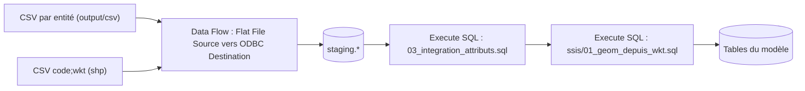

# Guide SSIS : intégration ETL vers PostgreSQL (TP1 Geo BI)

Objectif : refaire avec **SSIS** (Visual Studio 2022) l'intégration réalisée en partie II :
fichiers sources → `staging` → tables du modèle (id + clés étrangères) → géométries.

---

## 0. Prérequis (une seule fois)

| Élément | Où / comment |
| --- | --- |
| Visual Studio 2022 + extension **SQL Server Integration Services Projects 2022** | Extensions → Gérer les extensions → Marketplace |
| **psqlODBC** (driver ODBC PostgreSQL) **x64 et x86** | <https://www.postgresql.org/ftp/odbc/releases/> (fichier `psqlodbc_x64.msi` + `psqlodbc_x86.msi`) |
| DSN ODBC `geobi_tp1` | `odbcad32.exe` (64 bits) **et** `C:\Windows\SysWOW64\odbcad32.exe` (32 bits) → DSN système → **PostgreSQL Unicode** : serveur `localhost`, port `5432`, base `geobi_tp1`, user `postgres` |
| Base + tables vides | `sql/01_create_database.sql` puis `sql/02_schema.sql` (partie I) |
| Fichiers sources | `python scripts/01_excel_par_entite.py` (CSV par entité) et `python scripts/04_export_wkt_pour_ssis.py` (CSV `code;wkt`) |

> [!IMPORTANT]
> SSIS n'a pas de fournisseur OLE DB natif pour PostgreSQL : on passe par **ODBC**.
> Installez le driver en x86 **et** x64 : le concepteur et l'exécution n'utilisent pas toujours la même architecture
> (propriété du projet *Debugging → Run64BitRuntime*).

> [!TIP]
> On utilise les **CSV** (UTF-8, séparateur `;`) plutôt que l'Excel Source : cela évite d'installer le
> pilote *Microsoft Access Database Engine* (ACE) et les problèmes 32/64 bits qui vont avec.

---

## 1. Projet et gestionnaires de connexions

1. *Nouveau projet* → **Integration Services Project** → `GeoBI_TP1_SSIS`.
2. Clic droit dans **Connection Managers** → *New Connection…* → **ODBC** → *Use user or system data source name* → `geobi_tp1` → *Test Connection*. Nommez-le `PG_geobi`.
3. Pour chaque CSV de `output/csv`, créez une connexion **Flat File** :
   - *Code page* : **65001 (UTF-8)**, *Format* : Delimited, *Column delimiter* : **Semicolon {;}**, cochez *Column names in the first data row*.
   - Onglet **Advanced** : mettez toutes les colonnes de code en **DT_WSTR** pour garder les zéros de tête (`01`, `066`).
     Les colonnes `menages`, `population`, `etrangers` et `marocains` peuvent rester en **DT_I4**.
   - Pour les 3 fichiers `shp_*_wkt.csv` : colonne `wkt` en **DT_NTEXT** (Unicode text stream), car les WKT dépassent 4 000 caractères.

---

## 2. Control Flow du package

| # | Tâche | Type | Contenu |
| --- | --- | --- | --- |
| 1 | `SQL - Préparer staging` | Execute SQL Task (ODBC `PG_geobi`) | collez le contenu de `sql/ssis/00_staging_ssis.sql` |
| 2 | `DFT - Charger staging attributs` | Data Flow Task | 7 flux : CSV → `staging.<entité>` |
| 3 | `DFT - Charger staging géométries` | Data Flow Task | 3 flux : `shp_*_wkt.csv` → `staging.shp_*_wkt` |
| 4 | `SQL - Intégrer attributs` | Execute SQL Task (ODBC) | contenu de `sql/03_integration_attributs.sql` (codes → id, FK) |
| 5 | `SQL - Intégrer géométries` | Execute SQL Task (ODBC) | contenu de `sql/ssis/01_geom_depuis_wkt.sql` |
| 6 | `SQL - Contrôles` (facultatif) | Execute SQL Task | requêtes 1, 3 et 4 de `sql/05_controles.sql` |

Reliez les tâches 1 → 2 → 3 → 4 → 5 → 6 par des contraintes de précédence **Success** (flèches vertes).

### Détail d'un flux de données (tâches 2 et 3)

Pour chaque entité :

1. **Flat File Source** → connexion du CSV.
2. *(facultatif)* **Data Conversion** si un type ne correspond pas.
3. **ODBC Destination** → connexion `PG_geobi`, *Data access mode* : **Table Name - Batch**, table `staging.<entité>` → onglet *Mappings* : vérifiez la correspondance colonne par colonne.

> [!NOTE]
> Pour les colonnes `DT_NTEXT` (WKT), l'ODBC Destination repasse en mode ligne par ligne. Avec 1 538 communes, c'est sans conséquence.

---

## 3. Variante « 100 % ETL » : résoudre les clés étrangères dans SSIS (Lookup)

La version ci-dessus résout les FK en SQL (tâche 4). Pour montrer la transformation **Lookup**, on peut faire la même chose dans les Data Flows.
Le composant Lookup n'accepte que **OLE DB** ou un **cache** : avec PostgreSQL, on passe par un **Cache Connection Manager**.

Exemple pour `province_prefecture` (à reproduire pour cercle, commune, etc. dans l'ordre des dépendances) :

1. **DFT - Cache région** : *ODBC Source* `SELECT code, id FROM region` → **Cache Transform**
   (nouveau *Cache Connection Manager*, colonne `code` avec *Index Position* = 1).
2. **DFT - Province** :
   - *Flat File Source* `province_prefecture.csv`
   - **Lookup** → *Connection type* : **Cache connection manager** → jointure `region_code` = `code` → cochez `id`, renommé `region_id`
     → *No match* : **Redirect rows to no match output** (vers un fichier de rejets).
   - *ODBC Destination* → table `public.province_prefecture` (mappez `code`, `nom`, `type`, `region_id`).
3. Pour `commune`, le cercle est facultatif : dans le Lookup du cercle, choisissez *Ignore failure* pour que `cercle_id` reste NULL chez les municipalités.

> [!WARNING]
> Videz les tables avant de relancer (Execute SQL Task :
> `TRUNCATE stat_centre_urbain, centre_urbain, stat_commune, commune, cercle, province_prefecture, region RESTART IDENTITY CASCADE;`),
> sinon les contraintes `UNIQUE (code)` font échouer le chargement.

---

## 4. Exécution et vérification

- **F5** (ou clic droit sur le package → *Execute Package*) : toutes les tâches doivent passer au vert.
- Dans pgAdmin / psql : `\i sql/05_controles.sql`. Les volumes attendus sont 16 / 75 / 204 / 1 538 / 1 538 / 149 / 149, avec 0 géométrie manquante et 0 géométrie invalide.

### Erreurs fréquentes

| Message | Cause / solution |
| --- | --- |
| `Data source name not found` | DSN créé dans une seule architecture → créez-le en 32 **et** 64 bits |
| Codes `1` au lieu de `01` | colonne lue en numérique → passez-la en DT_WSTR dans la connexion Flat File |
| Caractères accentués corrompus (`é`) | code page du Flat File ≠ 65001, ou DSN « ANSI » au lieu de « Unicode » |
| `duplicate key value violates unique constraint` | tables non vidées avant la relance |
| Troncature sur `wkt` | colonne en DT_WSTR(50) → DT_NTEXT |
