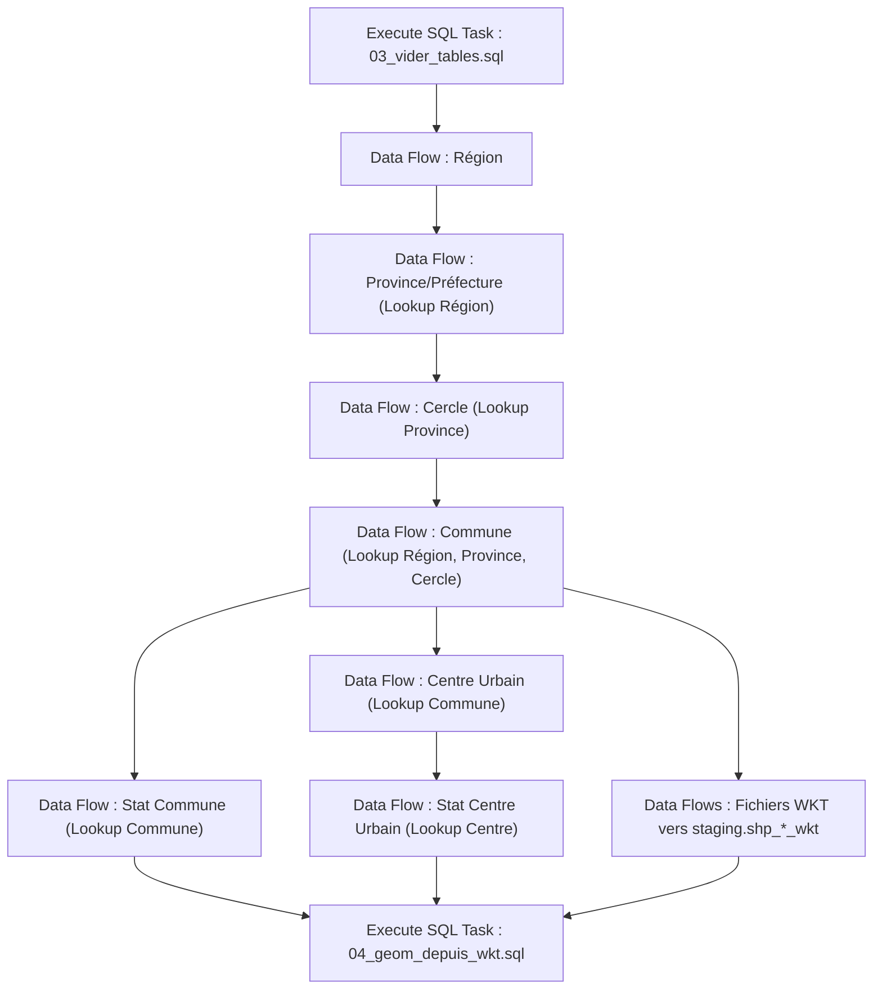

# Guide Complet SSIS avec SQL Server (Projet GeoBI_TP1_SSIS)

Ce guide détaille la mise en œuvre pas-à-pas du package SSIS dans Visual Studio pour charger les données dans **SQL Server** (`.\SQLEXPRESS`, base `GeoBI_SSIS`).

---

## 1. Architecture Globale du Flux



---

## 2. Configuration des Gestionnaires de Connexions (Connection Managers)

Dans votre projet Visual Studio (`GeoBI_TP1_SSIS`) :

### A. Connexion OLE DB vers SQL Server
- Clic droit dans la zone **Gestionnaires de connexions** (en bas) > **Nouvelle connexion OLE DB...**
- Fournisseur : **Microsoft OLE DB Driver for SQL Server** (ou *Native Client*)
- Nom du serveur : `.\SQLEXPRESS` (ou `localhost\SQLEXPRESS`)
- Authentification : **Authentification Windows**
- Sélectionner la base : `GeoBI_SSIS`
- Renommer la connexion : `OLEDB_GeoBI_SSIS`

### B. Connexions Fichiers / Sources
1. **Source Excel (Données attributaires)** :
   - Fichier : `C:\Projets\GeoBI\output\donnees_par_entite.xlsx`
   - *Note importante* : Dans les propriétés du projet SSIS > **Débogage (Debugging)** > Définir **Run64BitRuntime = True** (car le pilote Microsoft.ACE.OLEDB 64 bits est déjà installé sur votre machine).
2. **Sources Fichiers Plats (Géométries WKT)** :
   - Créer 3 connexions **Flat File Connection Manager** pointant vers :
     - `C:\Projets\GeoBI\output\csv\shp_region_wkt.csv`
     - `C:\Projets\GeoBI\output\csv\shp_province_wkt.csv`
     - `C:\Projets\GeoBI\output\csv\shp_commune_wkt.csv`
   - Délimiteur de colonne : point-virgule `{;}`
   - Format : Délimité, UTF-8 (Code page 65001)
   - Dans l'onglet **Avancé**, typer la colonne `wkt` en **flux de texte Unicode [DT_NTEXT]** (ou `DT_WSTR` 4000+).

---

## 3. Détail des Tâches du Flux de Contrôle (Control Flow)

### Étape 0 : Nettoyage avant exécution
- **Type** : *Execute SQL Task*
- **Nom** : `SQL - Vider tables et réinitialiser compteurs`
- **Connection** : `OLEDB_GeoBI_SSIS`
- **SQLStatement** : Coller le contenu de [03_vider_tables.sql](file:///c:/Projets/GeoBI/sql/sqlserver/03_vider_tables.sql)

---

### Étape 1 : Chargement de `region`
- **Data Flow Task** : `DFT - Region`
- **Source** : Excel Source (`donnees_par_entite.xlsx`, feuille `'region$'`)
- **Destination** : OLE DB Destination (`dbo.region`)
  - Colonnes mappées : `code` -> `code`, `nom` -> `nom`.

---

### Étape 2 : Chargement de `province_prefecture`
- **Data Flow Task** : `DFT - Province`
- **Source** : Excel Source (feuille `'province_prefecture$'`)
- **Transformation Lookup** (`Lookup Region`) :
  - Mode connexion : *Full cache*
  - Type de connexion : *OLE DB connection manager* (`OLEDB_GeoBI_SSIS`)
  - Requête : `SELECT id, code FROM dbo.region`
  - Onglet Colonnes : Relier `region_code` (source) avec `code` (Lookup). Cocher `id` et le renommer en `region_id`.
- **Destination** : OLE DB Destination (`dbo.province_prefecture`)
  - Mapper `code`, `nom`, `type`, `region_id`.

---

### Étape 3 : Chargement de `cercle`
- **Data Flow Task** : `DFT - Cercle`
- **Source** : Excel Source (feuille `'cercle$'`)
- **Transformation Lookup** (`Lookup Province`) :
  - Requête : `SELECT id, code FROM dbo.province_prefecture`
  - Jointure : `province_code` = `code`
  - Sortie ajoutée : `id` renommé en `province_prefecture_id`
- **Destination** : OLE DB Destination (`dbo.cercle`)

---

### Étape 4 : Chargement de `commune`
- **Data Flow Task** : `DFT - Commune`
- **Source** : Excel Source (feuille `'commune$'`)
- **Lookup 1** (`Lookup Region`) : Jointure sur `region_code`, récupère `region_id`.
- **Lookup 2** (`Lookup Province`) : Jointure sur `province_code`, récupère `province_prefecture_id`.
- **Lookup 3** (`Lookup Cercle`) :
  - Jointure sur `cercle_code` = `code`, récupère `cercle_id`.
  - **Important** : Pour les lignes sans correspondance (ex: municipalités sans cercle), régler *Specify how to handle rows with no matching entries* sur **Ignore failure** afin que `cercle_id` prenne la valeur `NULL`.
- **Destination** : OLE DB Destination (`dbo.commune`)

---

### Étape 5 : Chargement des Statistiques et Centres Urbains
- **`DFT - Stat Commune`** :
  - Source Excel `'stat_commune$'`
  - Lookup `commune` sur `commune_code` = `code` pour récupérer `commune_id`.
  - Destination : `dbo.stat_commune`.
- **`DFT - Centre Urbain`** :
  - Source Excel `'centre_urbain$'`
  - Lookup `commune` sur `commune_code` = `code` pour récupérer `commune_id`.
  - Destination : `dbo.centre_urbain`.
- **`DFT - Stat Centre Urbain`** :
  - Source Excel `'stat_centre_urbain$'`
  - Lookup `centre_urbain` sur `centre_urbain_code` = `code` pour récupérer `centre_urbain_id`.
  - Destination : `dbo.stat_centre_urbain`.

---

### Étape 6 : Chargement des WKT et Conversion Spatiale
- **Tâche Data Flow** : `DFT - Staging WKT`
  - 3 flux simples : Flat File Source (`shp_*_wkt.csv`) -> OLE DB Destination (`staging.shp_*_wkt`).
- **Tâche Execute SQL finale** : `SQL - Intégrer géométries WKT`
  - Fichier SQL : [04_geom_depuis_wkt.sql](file:///c:/Projets/GeoBI/sql/sqlserver/04_geom_depuis_wkt.sql)
  - Met à jour la colonne `geom` dans `region`, `province_prefecture`, et `commune` via `geometry::STGeomFromText(s.wkt, 4326).MakeValid()`.

---

## 4. Vérification et Validation

Une fois le package exécuté dans Visual Studio, exécutez le script de contrôle :
```powershell
sqlcmd -S .\SQLEXPRESS -E -C -d GeoBI_SSIS -i "sql\sqlserver\05_controles.sql" -W
```

Résultats attendus :
- **16** régions
- **75** provinces / préfectures
- **204** cercles & préfectures d'arrondissements
- **1 538** communes
- **149** centres urbains
- **0** géométrie manquante ou invalide.
