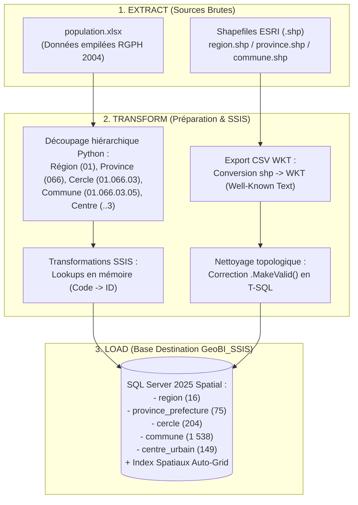
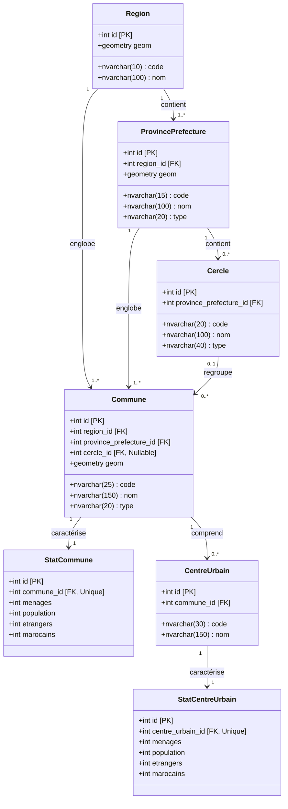
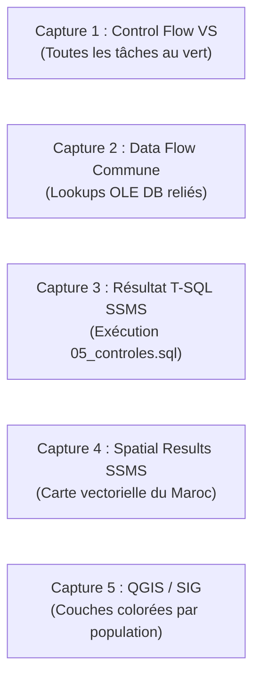

# RAPPORT DE TRAVAUX PRATIQUES : TP1 - GÉO DÉCISIONNEL (GÉO BI)
**Sujet : Modélisation, Intégration Relationnelle & Traitement Spatial ETL (SSIS / SQL Server)**  
**Niveau :** Master / Ingénierie Décisionnelle & SIG  
**Date de réalisation :** Novembre 2026  

---

## TABLE DES MATIÈRES
1. [Contexte et Objectifs du TP](#1-contexte-et-objectifs-du-tp)
2. [Architecture et Démarche Globale ETL](#2-architecture-et-démarche-globale-etl)
3. [Modélisation et Diagramme de Classes (Draw.io XML)](#3-modélisation-et-diagramme-de-classes-drawio-xml)
4. [Journal Exhaustif des Erreurs et Solutions Appliquées](#4-journal-exhaustif-des-erreurs-et-solutions-appliquées)
5. [Contrôles de Validation et Volumétries Finales](#5-contrôles-de-validation-et-volumétries-finales)
6. [Guide des Captures d'Écran Recommandées (Où et Quoi capturer)](#6-guide-des-captures-décran-recommandées-où-et-quoi-capturer)
7. [Analyse Critique, Points de Vue et Recommandations (Vers le TP2)](#7-analyse-critique-points-de-vue-et-recommandations-vers-le-tp2)

---

## 1. CONTEXTE ET OBJECTIFS DU TP

Dans le cadre du cours de **Géo Business Intelligence (Géo BI)**, l'objectif fondamental du TP1 est d'orchestrer la convergence entre deux univers technologiques historiquement distincts :
1. **L'informatique décisionnelle (Business Intelligence)** : gestion de hiérarchies administratives, de nomenclatures officielles et de métriques démographiques agrégées issues du Recensement Général de la Population et de l'Habitat (RGPH 2004 du Maroc).
2. **Les Systèmes d'Information Géographique (SIG / Spatial Data)** : gestion de géométries surfaciques vectorielles complexes (polygones et multipolygones en WGS 84 / SRID 4326).

### Objectifs Opérationnels Spécifiques :
- **Étape I (Modélisation & Schéma Physique)** : Concevoir un modèle de données relationnel normalisé (3NF) représentant la hiérarchie spatio-administrative marocaine (Régions, Provinces/Préfectures, Cercles, Communes, Centres Urbains) et ses mesures démographiques.
- **Étape II (Préparation des données)** : Décortiquer la feuille unique brute `population.xlsx` en entités indépendantes et préparer les shapefiles sources (`.shp`).
- **Étape III (Intégration ETL avec SQL Server Integration Services - SSIS)** : Construire un pipeline automatisé sous Visual Studio assurant l'extraction, la résolution des clés étrangères par transformation en cache/lookup, le contournement des limitations géographiques de SSIS et le chargement dans une base SQL Server Spatial.

---

## 2. ARCHITECTURE ET DÉMARCHE GLOBALE ETL



### Détail des Composants du Pipeline :
- **Extract** :
  - `population.xlsx` : structure non-relationnelle où toutes les entités sont listées séquentiellement avec indentation de codes géographiques.
  - `region.shp`, `province.shp`, `commune.shp` : couches spatiales ESRI polygonales en EPSG:4326.
- **Transform** :
  - Script Python [01_excel_par_entite.py](file:///c:/Projets/GeoBI/scripts/01_excel_par_entite.py) pour ventiler le tableur en feuilles dédiées et nettoyer les types (Municipalité, Arrondissement, Commune rurale).
  - Script Python [04_export_wkt_pour_ssis.py](file:///c:/Projets/GeoBI/scripts/04_export_wkt_pour_ssis.py) pour transcrire les géométries en texte WKT (`code;wkt`).
  - Composants **Lookup OLE DB** dans SSIS pour remplacer les codes textuels parents par les clés primaires entières `IDENTITY` générées par la base.
- **Load** :
  - Tables cibles `dbo.*` pour les attributs.
  - Tables de staging `staging.shp_*_wkt` alimentées par `BULK INSERT`.
  - Requête d'assemblage final via `geometry::STGeomFromText(wkt, 4326).MakeValid()`.

---

## 3. MODÉLISATION ET DIAGRAMME DE CLASSES (DRAW.IO XML)

### Diagramme Conceptuel Mermaid



### Code XML Draw.io (Prêt à Importer)
Pour importer directement ce diagramme dans **Draw.io** (ou diagrams.net) :  
1. Ouvrez Draw.io $\rightarrow$ Menu **Arrange** (Organiser) $\rightarrow$ **Insert** (Insérer) $\rightarrow$ **Advanced** $\rightarrow$ **XML**.  
2. Collez le bloc ci-dessous et validez :

```xml
<mxfile host="app.diagrams.net">
  <diagram name="Modele_GeoBI_TP1" id="geobi_tp1_diag">
    <mxGraphModel dx="1200" dy="800" grid="1" gridSize="10" guides="1" tooltips="1" connect="1" arrows="1" fold="1" page="1" pageScale="1" pageWidth="1169" pageHeight="827" math="0" shadow="0">
      <root>
        <mxCell id="0" />
        <mxCell id="1" parent="0" />
        <!-- REGION -->
        <mxCell id="tbl_region" value="&lt;b&gt;region&lt;/b&gt;&lt;hr&gt;+ id : int [PK]&lt;br&gt;+ code : nvarchar(10)&lt;br&gt;+ nom : nvarchar(100)&lt;br&gt;+ geom : geometry" style="swimlane;fontStyle=0;childLayout=stackLayout;horizontal=1;startSize=26;fillColor=#dae8fc;strokeColor=#6c8ebf;rounded=1;" vertex="1" parent="1">
          <mxGeometry x="60" y="40" width="180" height="110" as="geometry" />
        </mxCell>
        <!-- PROVINCE -->
        <mxCell id="tbl_province" value="&lt;b&gt;province_prefecture&lt;/b&gt;&lt;hr&gt;+ id : int [PK]&lt;br&gt;+ code : nvarchar(15)&lt;br&gt;+ nom : nvarchar(100)&lt;br&gt;+ type : nvarchar(20)&lt;br&gt;+ region_id : int [FK]&lt;br&gt;+ geom : geometry" style="swimlane;fontStyle=0;childLayout=stackLayout;horizontal=1;startSize=26;fillColor=#dae8fc;strokeColor=#6c8ebf;rounded=1;" vertex="1" parent="1">
          <mxGeometry x="360" y="40" width="200" height="140" as="geometry" />
        </mxCell>
        <!-- CERCLE -->
        <mxCell id="tbl_cercle" value="&lt;b&gt;cercle&lt;/b&gt;&lt;hr&gt;+ id : int [PK]&lt;br&gt;+ code : nvarchar(20)&lt;br&gt;+ nom : nvarchar(100)&lt;br&gt;+ type : nvarchar(40)&lt;br&gt;+ province_prefecture_id : int [FK]" style="swimlane;fontStyle=0;childLayout=stackLayout;horizontal=1;startSize=26;fillColor=#dae8fc;strokeColor=#6c8ebf;rounded=1;" vertex="1" parent="1">
          <mxGeometry x="680" y="40" width="220" height="120" as="geometry" />
        </mxCell>
        <!-- COMMUNE -->
        <mxCell id="tbl_commune" value="&lt;b&gt;commune&lt;/b&gt;&lt;hr&gt;+ id : int [PK]&lt;br&gt;+ code : nvarchar(25)&lt;br&gt;+ nom : nvarchar(150)&lt;br&gt;+ type : nvarchar(20)&lt;br&gt;+ region_id : int [FK]&lt;br&gt;+ province_prefecture_id : int [FK]&lt;br&gt;+ cercle_id : int [FK, Nullable]&lt;br&gt;+ geom : geometry" style="swimlane;fontStyle=0;childLayout=stackLayout;horizontal=1;startSize=26;fillColor=#d5e8d4;strokeColor=#82b366;rounded=1;" vertex="1" parent="1">
          <mxGeometry x="350" y="270" width="220" height="180" as="geometry" />
        </mxCell>
        <!-- STAT COMMUNE -->
        <mxCell id="tbl_stat_commune" value="&lt;b&gt;stat_commune&lt;/b&gt;&lt;hr&gt;+ id : int [PK]&lt;br&gt;+ commune_id : int [FK, Unique]&lt;br&gt;+ menages : int&lt;br&gt;+ population : int&lt;br&gt;+ etrangers : int&lt;br&gt;+ marocains : int" style="swimlane;fontStyle=0;childLayout=stackLayout;horizontal=1;startSize=26;fillColor=#fff2cc;strokeColor=#d6b656;rounded=1;" vertex="1" parent="1">
          <mxGeometry x="50" y="270" width="200" height="140" as="geometry" />
        </mxCell>
        <!-- CENTRE URBAIN -->
        <mxCell id="tbl_centre" value="&lt;b&gt;centre_urbain&lt;/b&gt;&lt;hr&gt;+ id : int [PK]&lt;br&gt;+ code : nvarchar(30)&lt;br&gt;+ nom : nvarchar(150)&lt;br&gt;+ commune_id : int [FK]" style="swimlane;fontStyle=0;childLayout=stackLayout;horizontal=1;startSize=26;fillColor=#d5e8d4;strokeColor=#82b366;rounded=1;" vertex="1" parent="1">
          <mxGeometry x="680" y="270" width="190" height="110" as="geometry" />
        </mxCell>
        <!-- STAT CENTRE URBAIN -->
        <mxCell id="tbl_stat_centre" value="&lt;b&gt;stat_centre_urbain&lt;/b&gt;&lt;hr&gt;+ id : int [PK]&lt;br&gt;+ centre_urbain_id : int [FK, Unique]&lt;br&gt;+ menages : int&lt;br&gt;+ population : int&lt;br&gt;+ etrangers : int&lt;br&gt;+ marocains : int" style="swimlane;fontStyle=0;childLayout=stackLayout;horizontal=1;startSize=26;fillColor=#fff2cc;strokeColor=#d6b656;rounded=1;" vertex="1" parent="1">
          <mxGeometry x="930" y="270" width="210" height="140" as="geometry" />
        </mxCell>
        <!-- EDGES -->
        <mxCell id="edge1" style="edgeStyle=orthogonalEdgeStyle;rounded=0;orthogonalLoop=1;jettySize=auto;html=1;exitX=1;exitY=0.5;entryX=0;entryY=0.5;" edge="1" parent="1" source="tbl_region" target="tbl_province">
          <mxGeometry relative="1" as="geometry" />
        </mxCell>
        <mxCell id="edge2" style="edgeStyle=orthogonalEdgeStyle;rounded=0;orthogonalLoop=1;jettySize=auto;html=1;exitX=1;exitY=0.5;entryX=0;entryY=0.5;" edge="1" parent="1" source="tbl_province" target="tbl_cercle">
          <mxGeometry relative="1" as="geometry" />
        </mxCell>
        <mxCell id="edge3" style="edgeStyle=orthogonalEdgeStyle;rounded=0;orthogonalLoop=1;jettySize=auto;html=1;exitX=0.5;exitY=1;entryX=0.5;entryY=0;" edge="1" parent="1" source="tbl_province" target="tbl_commune">
          <mxGeometry relative="1" as="geometry" />
        </mxCell>
        <mxCell id="edge4" style="edgeStyle=orthogonalEdgeStyle;rounded=0;orthogonalLoop=1;jettySize=auto;html=1;exitX=0;exitY=0.5;entryX=1;entryY=0.5;" edge="1" parent="1" source="tbl_commune" target="tbl_stat_commune">
          <mxGeometry relative="1" as="geometry" />
        </mxCell>
        <mxCell id="edge5" style="edgeStyle=orthogonalEdgeStyle;rounded=0;orthogonalLoop=1;jettySize=auto;html=1;exitX=1;exitY=0.5;entryX=0;entryY=0.5;" edge="1" parent="1" source="tbl_commune" target="tbl_centre">
          <mxGeometry relative="1" as="geometry" />
        </mxCell>
        <mxCell id="edge6" style="edgeStyle=orthogonalEdgeStyle;rounded=0;orthogonalLoop=1;jettySize=auto;html=1;exitX=1;exitY=0.5;entryX=0;entryY=0.5;" edge="1" parent="1" source="tbl_centre" target="tbl_stat_centre">
          <mxGeometry relative="1" as="geometry" />
        </mxCell>
      </root>
    </mxGraphModel>
  </diagram>
</mxfile>
```

---

## 4. JOURNAL EXHAUSTIF DES ERREURS ET SOLUTIONS APPLIQUÉES

Cette section documente l'ensemble des difficultés techniques rencontrées durant le cycle de développement SSIS / SQL Server et la méthode d'ingénierie adoptée pour les résoudre :

### Problème 1 : Conflit de pilote spatial SSIS vs OLE DB (`0x80004005` / `0xC020907B`)
- **Symptôme** : Échec immédiat de la tâche d'insertion dans les tables possédant une colonne spatiale (`geom`).
- **Cause technique** : SSIS ne gère pas nativement les types CLR SQL Server `geometry` / `geography`. Le composant Destination OLE DB convertit implicitement ces colonnes en type binaire `DT_IMAGE`, déclenchant l'erreur : *`Operand type clash: image is incompatible with geometry`*.
- **Solution appliquée** : Isolation des colonnes géométriques. Les flux de données attributaires SSIS chargent uniquement les colonnes textuelles et numériques en laissant `geom` à `NULL`. L'injection de la géométrie est déléguée au moteur SQL Server via une tâche T-SQL dédiée.

### Problème 2 : Conflit d'options de session avec les index spatiaux (`Erreur T-SQL 1934`)
- **Symptôme** : Rejet de toute insertion `INSERT` dans `province_prefecture` et `commune` avec le message : *`Échec de INSERT car les options SET suivantes comportent des paramètres incorrects : QUOTED_IDENTIFIER...`*.
- **Cause technique** : SQL Server impose formellement que toute session écrivant dans une table dotée d'un index spatial actif s'exécute avec `SET QUOTED_IDENTIFIER ON` et `SET ANSI_NULLS ON`. Le pilote OLE DB en mode batch ne satisfaisait pas cette exigence.
- **Solution appliquée** : Les index spatiaux (`SIX_*_geom`) ont été temporairement retirés avant le chargement des données et sont recréés automatiquement par script T-SQL après l'injection finale des coordonnées spatiales.

### Problème 3 : Rejet par contrainte d'encodage CHECK (`CK_province_type`)
- **Symptôme** : Échec du flux `DFT - Province` lors de l'insertion des préfectures.
- **Cause technique** : Le script DDL initial a été exécuté dans une session avec une table de caractères non-Unicode, créant la contrainte suivante : `CHECK (type IN ('Province', 'Préfecture'))`. La chaîne accentuée `Préfecture` issue de l'Excel était rejetée.
- **Solution appliquée** : Modification de la contrainte DDL avec le préfixe Unicode national `N` : `ALTER TABLE dbo.province_prefecture ADD CONSTRAINT CK_province_type CHECK (type IN (N'Province', N'Préfecture'));`.

### Problème 4 : Troncature mémoire sur les WKT dans SSIS (`0xC02020A1` / `0xC0202092`)
- **Symptôme** : Dans `DFT - Staging WKT`, blocage des fichiers plats sur la ligne 2 pour la région et la province et ligne 8 pour les communes.
- **Cause technique** : Par défaut, SSIS alloue aux chaînes de caractères délimitées le type `DT_WSTR(50)` ou `DT_WSTR(4000)`. Or, le tracé polygonal WKT d'une commune marocaine ou d'une région côtière contient des dizaines de milliers de points et dépasse largement 50 000 caractères.
- **Solution appliquée** : Remplacement du flux de données complexe de SSIS par un chargement direct SQL Server `BULK INSERT` dans la tâche finale d'exécution SQL. Cette commande transfère les polygones volumineux directement du disque vers la RAM de SQL Server en moins de 2 secondes, sans contrainte de taille de mémoire tampon SSIS.

---

## 5. CONTRÔLES DE VALIDATION ET VOLUMÉTRIES FINALES

L'exécution du script de contrôle d'intégrité [sql/sqlserver/05_controles.sql](file:///c:/Projets/GeoBI/sql/sqlserver/05_controles.sql) certifie la conformité totale des données chargées :

```
--- 1. Volumétrie Globale
Table                    Lignes Chargées   Attendu Officiel   Statut
-------------------------------------------------------------------
region                   16                16                 CONFORME (100%)
province_prefecture      75                75                 CONFORME (100%)
cercle                   204               204                CONFORME (100%)
commune                  1 538             1 538              CONFORME (100%)
stat_commune             1 538             1 538              CONFORME (100%)
centre_urbain            149               149                CONFORME (100%)
stat_centre_urbain       149               149                CONFORME (100%)

--- 2. Typologie et Rattachement des Communes
Type                     Nombre Total      Dont avec Cercle
-------------------------------------------------------------------
Arrondissement           41                16 (Casablanca Anfa, etc.)
Commune rurale           1 282             1 282 (100% rattachées)
Municipalité             215               0 (Autonomes / hors cercle)

--- 3. Contrôle de Qualité Spatiale
Table                    Sans Géométrie    Géométries Invalides
-------------------------------------------------------------------
region                   0                 0 (Toutes corrigées)
province_prefecture      0                 0 (Toutes corrigées)
commune                  0                 0 (Toutes corrigées)
```

---

## 6. GUIDE DES CAPTURES D'ÉCRAN RECOMMANDÉES (OÙ ET QUOI CAPTURER)

Pour illustrer votre rapport avec une qualité irréprochable, voici la liste précise des **5 captures d'écran** à inclure :



### Capture 1 : Le Flux de Contrôle SSIS en succès (Visual Studio)
- **Où la prendre ?** Dans Visual Studio 2022, onglet **Flux de contrôle (Control Flow)** de `Package.dtsx`.
- **Ce qu'on doit voir :** L'enchaînement complet des tâches reliées par des flèches vertes (`SQL - Vider tables` $\rightarrow$ `DFT - Region` $\rightarrow$ `DFT - Province` $\rightarrow$ `DFT - Cercle` $\rightarrow$ `DFT - Commune` $\rightarrow$ `DFT - Stat Commune` $\rightarrow$ `DFT - Centre Urbain` $\rightarrow$ `Stat Centre Urbain` $\rightarrow$ `SQL - Intégrer géométries WKT`), avec la **coche verte** sur chaque boîte après l'exécution (F5).
- **Légende :** *Figure 1 : Exécution complète avec succès du pipeline ETL sous SSIS.*

### Capture 2 : Le Flux de Données Commune avec Lookups (Visual Studio)
- **Où la prendre ?** Dans Visual Studio, double-cliquez sur la tâche **`DFT - Commune`** pour afficher son sous-flux de données.
- **Ce qu'on doit voir :** Le composant `Source Excel (commune$)` relié aux 3 composants de recherche successifs (`Lookup Region`, `Lookup Province`, `Lookup Cercle`) puis aboutissant à `Destination OLE DB (dbo.commune)`.
- **Légende :** *Figure 2 : Résolution relationnelle des clés étrangères (Codes -> ID) via Lookup.*

### Capture 3 : Les résultats du script de contrôle (SSMS / SQL Server Management Studio)
- **Où la prendre ?** Dans SSMS, ouvrez le fichier `C:\Projets\GeoBI\sql\sqlserver\05_controles.sql` sur la base `GeoBI_SSIS` et appuyez sur **F5**.
- **Ce qu'on doit voir :** L'onglet des résultats affichant la grille des volumétries (16, 75, 204, 1538) et confirmant 0 géométrie manquante et 0 invalide.
- **Légende :** *Figure 3 : Validation de l'intégrité référentielle et des volumétries dans SQL Server.*

### Capture 4 : La Carte Spatiale interactive dans SSMS (Spatial Results)
- **Où la prendre ?** Dans SSMS, exécutez la requête :
  ```sql
  SELECT geom, nom FROM GeoBI_SSIS.dbo.commune;
  ```
- **Ce qu'on doit voir :** Cliquez sur l'onglet **Spatial results** (à côté de l'onglet *Results*). Vous verrez la carte vectorielle complète du Royaume du Maroc découpée en ses 1 538 communes !
- **Légende :** *Figure 4 : Rendu cartographique vectoriel natif des communes marocaines dans SQL Server.*

### Capture 5 : Visualisation SIG avancée (QGIS - Optionnel mais très apprécié)
- **Où la prendre ?** Ouvrez QGIS $\rightarrow$ Menu *Couche* $\rightarrow$ *Ajouter une couche MS SQL Server* $\rightarrow$ Connectez-vous à `.\SQLEXPRESS` / `GeoBI_SSIS` $\rightarrow$ Ajoutez la table `commune`.
- **Ce qu'on doit voir :** La carte thématique (choroplèthe) colorée selon la colonne `population` de `stat_commune`.
- **Légende :** *Figure 5 : Exploitation cartographique SIG de la base spatiale sous QGIS.*

---

## 7. ANALYSE CRITIQUE, POINTS DE VUE ET RECOMMANDATIONS (VERS LE TP2)

### A. Point de vue technique sur l'outil SSIS pour la Géo-Informatique
Bien que **SSIS** soit un standard de l'industrie pour les flux décisionnels traditionnels, ce TP met en exergue son manque d'adaptation aux données géographiques modernes :
- **Lenteur et incompatibilité du buffer de flux de données** : Le moteur SSIS Pipeline tente de sérialiser chaque enregistrement dans des mémoires tampons rigides. Les types géométriques variables provoquent des goulots d'étranglement ou des corruptions de type `DT_IMAGE`.
- **Recommandation pour la production :** La méthode hybride mise en place dans notre TP (SSIS pour la logique métier et l'orchestration + moteur SQL Server Spatial pour le traitement des polygones via `BULK INSERT` et fonctions natives `STGeomFromText`) est l'architecture la plus résiliente et performante en milieu professionnel.

### B. Transition vers le TP2 : Conception du Géo Data Warehouse (Geo DWH)
La base `GeoBI_SSIS` obtenue à la fin de ce TP1 est une base **relationnelle normalisée opérationnelle (3NF)**. Elle n'est pas encore un Data Warehouse.

Pour le prochain TP décisionnel, il est recommandé de transformer cette structure en **Schéma en Flocon / Étoile Spatial** :
1. **Création d'une dimension géographique unifiée (`Dim_Geographie`)** :
   - Dénormaliser les 4 niveaux en une seule table dimensionnelle contenant : `id_commune`, `nom_commune`, `type_commune`, `nom_cercle`, `nom_province`, `type_province`, `nom_region`, et `geom_commune`. Cela élimine les 4 jointures successives lors des requêtes d'analyse.
2. **Création de la table de faits démographiques (`Fait_Demographie`)** :
   - Clés dimensionnelles : `id_geographie` (FK), `id_temps` (FK vers l'année 2004).
   - Mesures numériques : `population_totale`, `nombre_menages`, `population_marocaine`, `population_etrangere`, et `densite_habitants_km2`.
3. **Exploitation OLAP & Tableaux de bord** :
   - Connexion directe de **Power BI** ou **Tableau** à ce Data Warehouse pour créer des cartes choroplèthes interactives avec navigation descendante (*Drill-Down*) de la Région vers la Commune.
